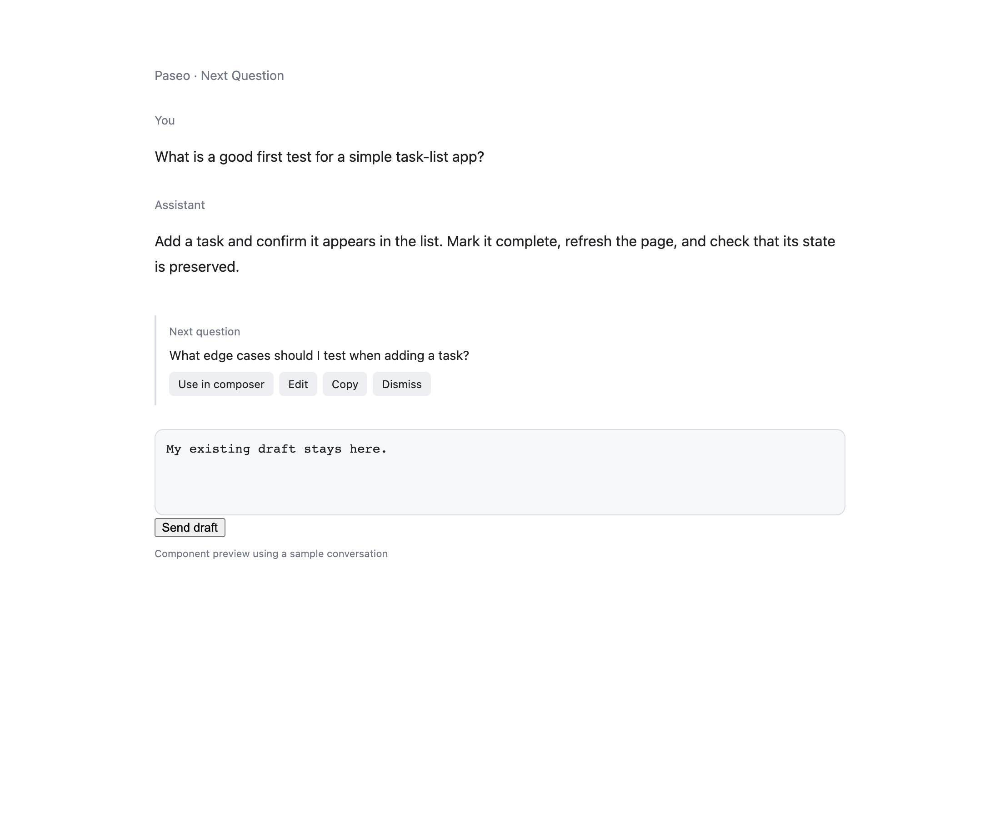

# Next Question for Paseo

One editable Codex-powered follow-up question below a completed reply, running inside standard Paseo 0.13.x.



The screenshots render the shipped component with a sample conversation and a mocked host. Real daemon and Codex checks are recorded in [verification](VERIFICATION.md).

## Install

```sh
paseo plugin install git:JacksonHuang517/paseo-next-question-plugin
```

Available in the [Paseo plugin directory](https://paseo.sh/plugins/jacksonhuang517/next-question). Requires plugins enabled and a current, configured Codex CLI on the daemon host. No custom desktop app is needed.

## Use

After a top-level agent finishes successfully, a suggestion row appears below the reply. On desktop or web, click the question text or **Use in composer** to put it into the original conversation input, then edit and send normally. An existing draft is preserved with the suggestion appended after a blank line; repeated clicks do not append the same suggestion again. You can also use **Edit → Send question** or **Copy**, including on mobile. Inserting a suggestion never sends it. Use `/next-question` for an older conversation or to recreate the row after restarting the daemon. Failed or canceled turns and provider child agents do not create automatic rows. The current interface uses English action labels; generated questions follow the conversation's language.

Read [the overview](OVERVIEW.md) / [中文说明](OVERVIEW.zh-CN.md) for data access, costs, requirements and limitations. Suggestions use public timeline APIs. Click-to-fill uses a narrowly scoped desktop/web adapter for the standard Paseo 0.13 input component; it does not need the earlier custom desktop app. This adapter depends on private UI details and may require maintenance after Paseo updates. If the input cannot be uniquely identified, the plugin leaves it unchanged and offers Copy/Edit.

## Development

```sh
npm ci
npm run typecheck
npm test
npm run lint
```

All dependencies are development-only or supplied by Paseo at runtime. Installation has no build step and runs no lifecycle scripts. `server/` contains the Codex process and bounded context reader; `client/` contains the native timeline UI; `shared/` contains RPC schemas. The server validates the latest reply before generation, after generation and immediately before an explicit send or filling the composer. Only the selected host and agent’s visible, editable composer can be filled. Generation is cached and canceled across simultaneous clients.

Do not add endpoints, credentials, local conversation dumps or identifying screenshot data to this repository. Release screenshots use a sample conversation. See [verification](VERIFICATION.md) for tested behavior and limits.
